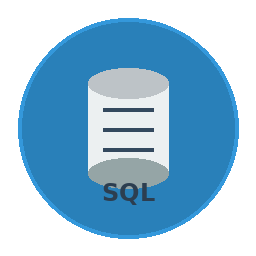

# SQLite Manager - Professional Database Management Tool

A comprehensive desktop application for managing SQLite databases with complete CRUD operations, advanced features, and an intuitive GUI interface.



## 🚀 Features

### Core Database Operations
- **Connection Management**: Connect to SQLite/SQLCipher databases with encryption support
- **Schema Management**: Create, modify, and drop tables, indexes, views, and triggers
- **Data Operations**: Full CRUD operations with batch processing capabilities
- **Transaction Control**: Manual and automatic transaction management
- **Query Execution**: Execute custom SQL with syntax validation and history

### Advanced Features
- **Multi-Record Selection**: Select and delete multiple records simultaneously
- **Data Visualization**: Generate charts (bar, line, pie, histogram, scatter plots)
- **Import/Export**: CSV and JSON support with column mapping
- **Query Manager**: Save favorite queries and track execution history
- **Backup/Restore**: Complete database backup and restoration
- **Theme Support**: Dark and light themes with smooth transitions

### User Interface
- **Split View Layout**: Schema tree on left, data tables on right
- **Multi-Tab Interface**: Open multiple tables simultaneously
- **Pagination**: Handle large datasets efficiently
- **Search & Filter**: Real-time data filtering and search
- **Context Menus**: Right-click operations throughout the interface
- **Keyboard Shortcuts**: Quick access to common operations

## 📋 Requirements

### System Requirements
- Python 3.8 or higher
- Linux/macOS/Windows
- 512MB RAM minimum
- 100MB disk space

### Python Dependencies
```bash
PyQt6 >= 6.4.0
pycryptodome >= 3.17.0
matplotlib >= 3.5.0
pandas >= 1.3.0
Pillow >= 9.0.0
```

## 🛠️ Installation

### Quick Install
```bash
# Clone or download the application
cd dbgui

# Install dependencies
pip install -r requirements.txt

# Run the application
python3 main.py
```

### Desktop Integration (Linux)
```bash
# Make desktop file executable
chmod +x sqlite-manager.desktop

# Install to applications menu
cp sqlite-manager.desktop ~/.local/share/applications/

# Update desktop database
update-desktop-database ~/.local/share/applications/
```

## 🎯 Usage Guide

### Getting Started
1. **Launch Application**: Run `python3 main.py` or use desktop shortcut
2. **Connect Database**: File → Connect to Database (Ctrl+O)
3. **Browse Schema**: Explore tables, views, and indexes in left panel
4. **View Data**: Double-click any table to open in new tab

### Basic Operations

#### Managing Records
- **Add Record**: Click ➕ button or press Ctrl+N
- **Edit Record**: Double-click row or click ✏️ button
- **Delete Records**: 
  - Select single record and click 🗑️
  - Select multiple records (Ctrl+click) and delete all at once
- **Search Data**: Use search box to filter records

#### SQL Operations
- **Execute SQL**: Edit → Execute SQL (Ctrl+E)
- **View History**: Edit → Query Manager (Ctrl+H)
- **Save Queries**: Mark frequently used queries as favorites

#### Data Management
- **Export Data**: Click 📤 button, choose CSV or JSON format
- **Import Data**: Click 📥 button, map columns and import
- **Visualize Data**: Click 📊 button to generate charts

### Advanced Features

#### Multi-Record Operations
```
1. Hold Ctrl and click multiple rows to select
2. Or hold Shift and click to select range
3. Click delete button to remove all selected records
4. Confirm deletion in dialog
```

#### Query Management
```sql
-- Save complex queries for reuse
SELECT customers.name, COUNT(orders.id) as order_count
FROM customers 
LEFT JOIN orders ON customers.id = orders.customer_id
GROUP BY customers.id
ORDER BY order_count DESC;
```

#### Data Visualization
- Select numeric columns for charts
- Choose from 5 chart types
- Interactive plots with zoom and pan
- Export visualizations as images

## 🏗️ Project Structure

```
dbgui/
├── main.py                     # Application entry point
├── requirements.txt            # Python dependencies
├── sqlite-manager.desktop      # Desktop integration file
├── create_icon.py             # Icon generation script
├── db/                        # Database operations
│   ├── connection.py          # Connection management
│   ├── operations.py          # CRUD operations
│   ├── queries.py            # Query execution
│   └── schema.py             # Schema management
├── ui/                        # User interface
│   ├── main_window.py        # Main application window
│   ├── table_view.py         # Data table display
│   ├── data_visualizer.py    # Chart generation
│   └── dialogs/              # Dialog windows
│       ├── connection_dialog.py
│       ├── sql_executor.py
│       ├── record_editor.py
│       ├── query_manager_dialog.py
│       ├── bulk_import_dialog.py
│       └── table_editor.py
├── utils/                     # Utility modules
│   ├── backup.py             # Backup operations
│   ├── export.py             # Import/export
│   ├── logger.py             # Logging system
│   ├── query_manager.py      # Query management
│   ├── session.py            # Session persistence
│   └── theme.py              # Theme management
└── resources/                 # Application resources
    ├── sqlite_manager.png     # Application icon
    └── styles.qss            # Stylesheets
```

## ⌨️ Keyboard Shortcuts

| Shortcut | Action |
|----------|--------|
| Ctrl+O | Connect to Database |
| Ctrl+N | Add New Record |
| Ctrl+E | Execute SQL |
| Ctrl+H | Query Manager |
| Ctrl+R | Refresh Data |
| Ctrl+F | Search/Filter |
| Delete | Delete Selected Records |
| F5 | Refresh Current View |
| Ctrl+T | New Tab |
| Ctrl+W | Close Tab |

## 🎨 Themes

The application supports multiple themes:
- **Light Theme**: Clean, professional appearance
- **Dark Theme**: Easy on the eyes for extended use
- **Auto Theme**: Follows system preferences

Switch themes via: View → Themes

## 🔧 Configuration

### Database Settings
- **Connection Timeout**: Configurable timeout for database operations
- **Page Size**: Adjust pagination size (10-1000 records)
- **Auto-commit**: Enable/disable automatic transaction commits

### UI Preferences
- **Theme Selection**: Light, dark, or auto
- **Font Size**: Adjustable interface font size
- **Column Width**: Auto-resize or manual column sizing

## 📊 Supported Data Types

| SQLite Type | Display | Input Validation |
|-------------|---------|------------------|
| INTEGER | Number | Numeric validation |
| REAL | Decimal | Float validation |
| TEXT | String | Length limits |
| BLOB | Binary | File upload |
| BOOLEAN | Checkbox | True/False |
| DATE | Date picker | Date format |
| DATETIME | DateTime picker | Timestamp format |

## 🔒 Security Features

- **SQLCipher Support**: Encrypted database connections
- **Input Validation**: SQL injection prevention
- **Transaction Safety**: Automatic rollback on errors
- **Backup Encryption**: Optional backup encryption

## 🐛 Troubleshooting

### Common Issues

**Connection Failed**
```
- Check file permissions
- Verify database file exists
- Ensure SQLite version compatibility
```

**Import Errors**
```
- Validate CSV format
- Check column mapping
- Verify data types match schema
```

**Performance Issues**
```
- Reduce page size for large tables
- Add indexes for frequently queried columns
- Use VACUUM to optimize database
```

### Log Files
Application logs are stored in `sqlite_manager.log` with detailed error information.

## 🤝 Contributing

### Development Setup
```bash
# Clone repository
git clone <repository-url>
cd dbgui

# Create virtual environment
python3 -m venv venv
source venv/bin/activate

# Install dependencies
pip install -r requirements.txt

# Run in development mode
python3 main.py
```

### Code Style
- Follow PEP 8 guidelines
- Use type hints
- Write comprehensive docstrings
- Maintain modular architecture

## 📄 License

This project is licensed under the MIT License - see the LICENSE file for details.

## 🆘 Support

For issues, feature requests, or questions:
1. Check the troubleshooting section
2. Review application logs
3. Create an issue in the project repository

## 🔄 Version History

### v1.0.0
- Initial release with core functionality
- Multi-record selection and deletion
- Data visualization capabilities
- Query management system
- Theme support
- Import/export functionality

---

**SQLite Manager** - Making database management simple and powerful.